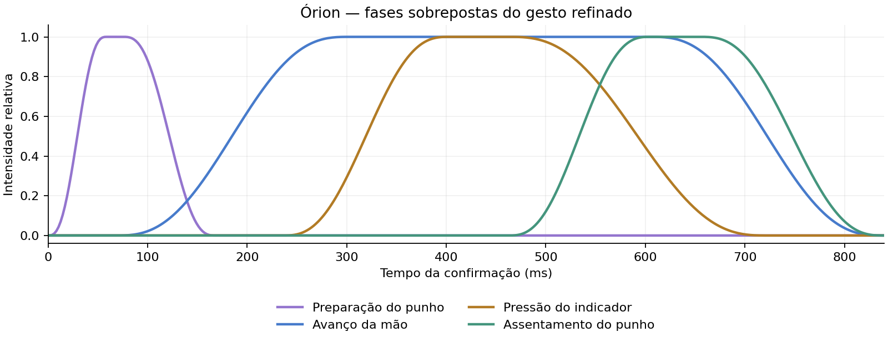

# Estudo e refinamento pequeno do rig 2,5D

Base: `058cd21`. Pedido de 19/10/2026: estudar animação por mesh/rig e melhorar um pouco o movimento da mão e a seleção da estrela. A anatomia/proporção anteriormente aprovada permanece a referência. Trabalho na mesma branch `codex/maos-rig-mmv`, PR #29.

## Estudo aplicado

O efeito MMV aqui é uma imagem com transparência aplicada a uma malha com pesos, ossos e morphs. Os ossos dão movimento local e os morphs preservam o contorno do indicador. O acabamento desta etapa trabalha o tempo e a sobreposição desses controles; os pesos, imagens, grade e contornos anatômicos permanecem os mesmos.

Referências primárias lidas em 19/10/2026:

| Referência | Observação | Aplicação neste projeto |
| --- | --- | --- |
| [Three.js r180 — SkinnedMesh](https://github.com/mrdoob/three.js/blob/r180/docs/api/en/objects/SkinnedMesh.html) | Skeleton, skinIndex/skinWeight e pose vinculam uma malha aos controles locais. | Manter os 18 controles e as influências normalizadas existentes; refinar as curvas que os dirigem. |
| [Spine 4.2 — CurveTimeline, RotateTimeline e DeformTimeline](https://github.com/EsotericSoftware/spine-runtimes/blob/e7dc1435fa4a0083ab431f1b28e083c14a1f5c68/spine-ts/spine-core/src/Animation.ts) | Rotação e deformação têm canais/curvas próprios; deformação ponderada usa offsets nos vértices. | Separar preparação, avanço, pressão e assentamento em fases sobrepostas do controlador nativo. |
| [Tween.js — easing, interpolação e sincronização](https://github.com/tweenjs/tween.js/blob/84a27a74febbda783eebb7ee3e7d7c7abfd25009/docs/user_guide.md) | Curvas de entrada/saída controlam aceleração; canais diferentes podem precisar de curvas próprias. Atualizações devem ser leves. | Curvas limitadas, relógio único e movimento secundário pequeno; sem percorrer vértices no update normal. |
| [Three.js r180 — Material.forceSinglePass](https://github.com/mrdoob/three.js/blob/r180/docs/api/en/materials/Material.html) | Transparência de dupla face usa duas passagens por padrão; superfícies planas podem usar uma. | Uma passagem por anel luminoso, preservando a geometria e o resultado visual. |

Essas fontes fundamentam a escolha de canais e curvas; antecipação e assentamento são decisões de direção de movimento para esta mão. Nenhum runtime, código ou asset do Spine/Tween.js foi incorporado.

## O que mudou

- **Apontamento:** na perspectiva, os dedos acomodam até 18% da amplitude dos ossos quando o gesto termina. Uma onda lenta, com peso máximo de 16%, quebra a repetição perfeitamente periódica nesse estado. Punho continua respirando; a mão neutra e os modos anteriores conservam o movimento original.
- **Clique:** pequeno recuo preparatório de até 0,012 unidade em Z, seguido do avanço existente de 0,09. Indicador mantém a pressão máxima anterior. Punho termina depois dele, com até 0,007 radiano de movimento secundário. Todos os canais voltam a zero antes da viagem.
- **Transições:** curva própria `6t⁵ − 15t⁴ + 10t³`, com velocidade e aceleração nulas nos encontros das fases. O progresso e as amplitudes permanecem limitados, sem extrapolar a textura.
- **Seleção da Nox:** primeira onda responde ao clique; a segunda começa aos 30% da confirmação e acompanha a pressão do indicador. Expansão desacelera, brilho recebe um pequeno acento no contato e opacidades máximas ficam ligeiramente menores. Mesmo raio máximo de 54 unidades, duas superfícies e nenhuma textura nova.

O gráfico mostra o controlador em tempo de animação. A duração nominal continua em 840 ms; o teto de passo de 100 ms conserva as fases após pausas longas de renderização. Reduced-motion conserva a confirmação estática e ao menos um quadro visível, com preparação/pressão/assentamento zerados.

## Evidências e validação

Check/build, cinco suítes unitárias e **10/10 testes de navegador aprovados**, sem retries, em 2,8 min. As unidades verificam recuo antes do avanço, assentamento após a pressão, menor energia dos dedos ao apontar, amplitudes limitadas e uma passagem por anel. Regressões de geometria/anatomia mantêm os limites anteriores: área relativa 0,1141668645–1,7116198024 na amostra de 41 progressos/quatro instantes. Nenhum limite relaxado.

No navegador: hover/retorno, gesto/viagem completos, clique repetido, toque/teclado/reduced/off, mesma textura e alpha de 0,46 na direita em perspectiva. Doze capturas cobrem antes e 8/25/50/75/92% em desktop/celular; a ponta permanece em x>0,70 da tela. Relógio congelado apenas nas capturas de fases; os cinco fluxos funcionais usam entrada/relógio reais e chegam à ficha.

- [Antes/depois em 50%](comparison.webp), com instantes de respiração ambiente independentes.
- Desktop: [antes](1920-before.webp), [preparação](1920-click-8.webp), [avanço](1920-click-25.webp), [pressão](1920-click-50.webp), [assentamento](1920-click-75.webp), [fim](1920-click-92.webp).
- Celular: [antes](390-before.webp), [preparação](390-click-8.webp), [avanço](390-click-25.webp), [pressão](390-click-50.webp), [assentamento](390-click-75.webp), [fim](390-click-92.webp).
- [Amostras e posições](metrics.json), [vídeo com mouse/relógio reais](refinement.mp4). Vídeo de 6,96 s. Gravação do canvas em 768×432, janela 1280×720, sem erros de página; navegação final interceptada com 204 só para exportar o vídeo. A navegação real é coberta pelos testes.

Evidência local Chromium/SwiftShader; sem inferir FPS/RAM no dispositivo do usuário. O CI remoto da nova revisão será conferido após o push. As capturas foram inspecionadas; o aceite artístico permanece com o usuário.

Código alterado: `star-selection.js`, `first-person-hands-mesh.js`, `hands-image-rig.js`; unidades e testes de navegador da seleção atualizados. Sem mudança de dependência, asset, desenho anatômico, fotografia ESO, crédito, câmera ou `star-journey.js`. Contexto e continuidade acompanham a entrega.

A avaliação artística da nova versão cabe ao usuário: abrir a nova prévia, passar/retirar o cursor e clicar na Nox. Nenhuma configuração, credencial ou arquivo adicional necessário.
